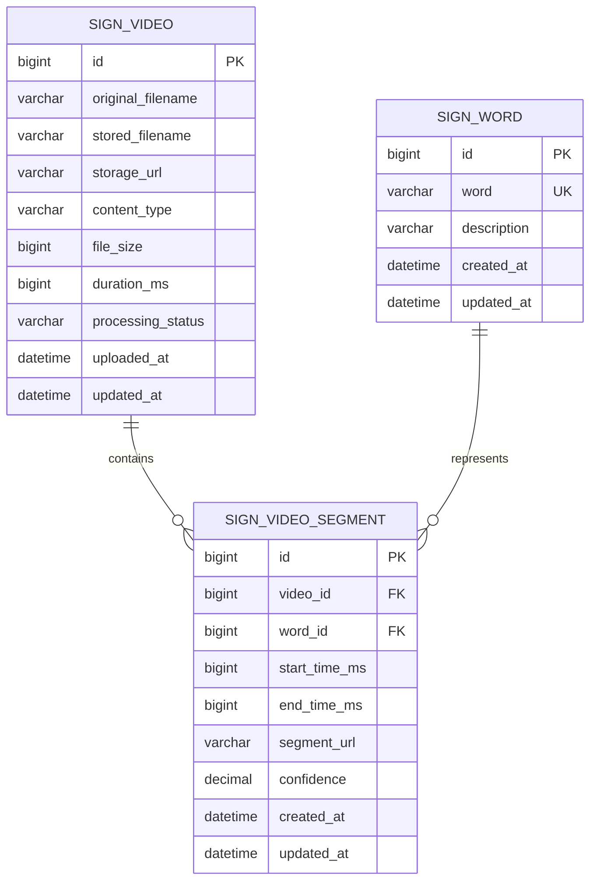

# 수어 영상 데이터 저장 프로젝트 준비 문서

## 1. 프로젝트 목표

수어 영상을 입력받아 영상에 포함된 수어를 단어 단위로 관리하고, 원본 영상·단어 구간·인식 결과를 데이터베이스에 저장한다.

최종 처리 흐름은 다음과 같다.

```text
영상 입력
→ 원본 영상 저장
→ 손 동작 분석
→ 단어와 시작/종료 시간 추출
→ 필요하면 단어별 영상 분할
→ 단어 및 영상 메타데이터 DB 저장
→ 단어별 영상 조회
```

## 2. 현재까지 구현된 내용

현재 저장소에는 Python 기반 손 추적 테스트 코드인 `ai-server/hand_tracker.py`가 구현되어 있다.

- OpenCV로 Mac 내장 웹캠 입력 수신
- 입력 영상을 좌우 반전하고 BGR에서 RGB로 변환
- MediaPipe Hands로 한 손의 랜드마크 추적
- 손가락 관절 좌표를 웹캠 화면에 실시간 표시
- 0.5초 간격으로 손가락이 펴졌는지 분석
- 규칙 기반으로 다음 세 가지 테스트 단어 출력
  - 검지만 편 상태: `병원 (Hospital)`
  - 네 손가락을 접은 상태: `아프다 (Sick)`
  - 네 손가락을 편 상태: `정상 (Normal)`
- 인식 결과를 콘솔과 웹캠 화면에 표시
- `q` 입력 시 카메라와 창을 정상적으로 종료
- Python 가상환경 `.venv`가 생성되어 있고 Git 추적 대상에서 제외됨

현재 코드는 실제 학습 모델이 아니라 손가락 상태를 조건문으로 구분하는 프로토타입이다. 엄지 좌표는 추출하지만 현재 단어 판별에는 사용하지 않는다.

## 3. 아직 구현되지 않은 내용

- Spring Boot 프로젝트
- 영상 파일 업로드 API
- 원본 및 단어별 영상 저장 기능
- MySQL 데이터베이스 연결
- 단어·영상·구간 Entity와 Repository
- FFmpeg 영상 분할
- Python 분석 서버와 Spring Boot 연동
- 학습된 수어 인식 모델
- 사용자 인증 및 권한 관리
- 테스트 코드와 배포 환경

## 4. 코드를 구현하기 전에 결정할 사항

### 4.1 MVP 범위

첫 번째 버전은 다음 범위로 제한한다.

1. 사용자가 수어 영상 파일을 업로드한다.
2. 사용자가 단어명과 시작/종료 시간을 직접 입력한다.
3. Spring Boot가 원본 영상과 구간 정보를 저장한다.
4. FFmpeg가 해당 구간을 단어별 영상으로 분할한다.
5. 단어를 검색하면 연결된 영상을 조회할 수 있다.

AI 자동 인식은 위 과정이 정상 동작한 다음 단계에서 연결한다. 이렇게 하면 AI 모델이 완성되지 않아도 백엔드와 데이터 저장 구조를 먼저 검증할 수 있다.

### 4.2 기술 스택

| 구분 | 선택안 |
| --- | --- |
| Backend | Java 21, Spring Boot 3.x, Gradle |
| API | Spring Web |
| ORM | Spring Data JPA |
| Database | MySQL 8 |
| Validation | Jakarta Validation |
| 영상 처리 | FFmpeg |
| AI/영상 분석 | Python, OpenCV, MediaPipe |
| API 연동 | HTTP REST API |
| 초기 파일 저장 | 서버 로컬 `uploads/` |
| 확장 시 파일 저장 | AWS S3 또는 MinIO |
| API 테스트 | Postman 또는 Swagger UI |

### 4.3 영상과 DB 저장 원칙

영상 파일 전체를 MySQL BLOB으로 저장하지 않는다. 영상은 파일 시스템 또는 Object Storage에 저장하고, DB에는 파일 경로와 메타데이터를 저장한다.

업로드 전에 다음 제한을 확정한다.

- 허용 확장자: 예) `mp4`, `mov`, `webm`
- 허용 MIME 타입
- 최대 파일 크기: 예) 500MB
- 최대 영상 길이
- 중복 파일 처리 기준
- 원본 영상 보관 기간
- 실패한 처리 파일 정리 정책

### 4.4 단어 구분 방식

다음 중 어떤 방식으로 단어의 시작과 끝을 얻을지 결정해야 한다.

- 1단계: 사용자가 단어명과 시작/종료 시간을 직접 입력
- 2단계: Python 서버가 영상 분석 결과를 반환
- 3단계: 학습 모델이 단어와 시간 구간을 자동 예측

초기 구현에서는 1단계를 사용하고, AI 응답도 동일한 데이터 형식을 사용하도록 설계한다.

```json
{
  "segments": [
    {
      "word": "병원",
      "startTimeMs": 0,
      "endTimeMs": 1800,
      "confidence": null
    }
  ]
}
```

## 5. 시스템 구성

```text
[클라이언트]
     │ 영상 업로드 / 구간 등록 / 조회
     ▼
[Spring Boot API]
     ├── MySQL: 단어, 영상 메타데이터, 시간 구간
     ├── File Storage: 원본 및 분할 영상
     ├── FFmpeg: 단어 구간 분할
     └── Python AI Server: 추후 영상 분석 요청
```

Spring Boot와 Python의 역할은 분리한다.

- Spring Boot: API, 검증, DB, 파일 관리, 처리 상태 관리
- Python: OpenCV·MediaPipe·학습 모델을 이용한 영상 분석
- FFmpeg: 영상 길이 확인, 인코딩, 구간 분할

## 6. ERD



### 테이블 역할

- `sign_video`: 업로드한 원본 영상과 처리 상태
- `sign_word`: 중복 없이 관리하는 수어 단어 사전
- `sign_video_segment`: 원본 영상의 특정 시간 구간과 단어의 연결

한 단어에는 여러 사람, 각도, 촬영 환경의 영상 구간이 연결될 수 있다. `confidence`는 AI 결과일 때 사용하고, 수동 입력일 때는 `NULL`을 허용한다.

## 7. Spring Boot 프로젝트 초기 설정

Spring Initializr 설정안은 다음과 같다.

```text
Project: Gradle - Groovy
Language: Java
Spring Boot: 안정된 3.x 버전
Group: com.example
Artifact: signlanguage
Package: com.example.signlanguage
Packaging: Jar
Java: 21
```

필수 의존성은 다음과 같다.

- Spring Web
- Spring Data JPA
- Validation
- MySQL Driver
- Lombok
- Spring Boot DevTools

추가 권장 의존성은 다음과 같다.

- Flyway Migration: DB 스키마 버전 관리
- Springdoc OpenAPI: Swagger API 문서
- Spring Security: 로그인 기능이 필요할 때 추가
- Spring Boot Actuator: 서버 상태 확인이 필요할 때 추가

## 8. 현재 폴더 구조

백엔드와 Python 분석 코드를 분리한다.

```text
project/
├── README.md
├── backend/
│   ├── build.gradle
│   └── src/
├── ai-server/
│   ├── hand_tracker.py
│   └── requirements.txt
├── uploads/
└── .gitignore
```

Python 손 추적 코드는 `ai-server/`로 분리했으며, 패키지 버전은 `ai-server/requirements.txt`에서 관리한다. `backend/`에는 이후 Spring Boot 프로젝트를 생성한다. `uploads/`에는 로컬 영상이 저장되지만 영상 파일 자체는 Git에서 제외된다.

### Python 프로토타입 실행

```bash
python3 -m venv .venv
source .venv/bin/activate
python -m pip install --upgrade pip
python -m pip install -r ai-server/requirements.txt
python ai-server/hand_tracker.py
```

macOS에서는 터미널 또는 IDE에 카메라 접근 권한을 허용해야 한다.

Spring Boot 내부는 기능 단위로 구성한다.

```text
com.example.signlanguage/
├── SignLanguageApplication.java
├── global/
│   ├── config/
│   ├── exception/
│   └── response/
└── sign/
    ├── controller/
    ├── dto/
    ├── entity/
    ├── repository/
    └── service/
```

## 9. 구현 예정 API

| Method | URL | 설명 |
| --- | --- | --- |
| POST | `/api/videos` | 원본 영상 업로드 |
| GET | `/api/videos/{videoId}` | 영상 정보 및 처리 상태 조회 |
| POST | `/api/videos/{videoId}/segments` | 단어별 시간 구간 등록 |
| GET | `/api/videos/{videoId}/segments` | 영상의 전체 단어 구간 조회 |
| POST | `/api/words` | 단어 등록 |
| GET | `/api/words` | 단어 목록 검색 |
| GET | `/api/words/{wordId}/segments` | 단어에 연결된 영상 조회 |
| DELETE | `/api/segments/{segmentId}` | 잘못 등록한 구간 삭제 |

## 10. 구현 전 체크리스트

### 개발 환경

- [ ] 팀에서 Java 21 사용 여부 확인
- [ ] Spring Boot 3.x 및 Gradle 사용 확정
- [ ] MySQL 8 설치 및 접속 확인
- [ ] FFmpeg 설치 및 명령 실행 확인
- [ ] IDE의 JDK 경로 통일
- [x] Python 3.9 이상으로 실행 환경 정의
- [x] `requirements.txt` 작성

### 기능과 데이터

- [ ] MVP에서 사용할 수어 단어 목록 확정
- [ ] 단어 하나당 필요한 최소 영상 개수 결정
- [ ] 한 영상에 단어가 하나인지 여러 개인지 확정
- [ ] 수동 구간 입력 화면 또는 요청 형식 확정
- [ ] 허용 영상 형식·크기·길이 확정
- [ ] 같은 단어와 영상의 중복 기준 확정
- [ ] 인식 신뢰도 기준 확정

### 보안과 운영

- [ ] DB 비밀번호를 환경변수로 관리
- [ ] 업로드 파일명을 UUID로 변경
- [ ] 파일 확장자와 실제 MIME 타입을 모두 검사
- [ ] `../`를 이용한 경로 이동 공격 방지
- [ ] `uploads/`, `.env`, 로컬 DB 설정을 `.gitignore`에 추가
- [ ] 처리 실패 상태와 재시도 정책 결정
- [ ] 원본 및 분할 영상 삭제 정책 결정

## 11. 구현 순서

1. 위 체크리스트와 MVP 범위를 팀에서 확정한다.
2. `backend/` Spring Boot 프로젝트를 생성한다.
3. MySQL 연결과 환경변수 설정을 완료한다.
4. ERD에 맞는 Entity, Repository, Migration을 작성한다.
5. 영상 업로드 및 로컬 파일 저장 API를 구현한다.
6. 단어와 영상 구간을 수동 등록하는 API를 구현한다.
7. FFmpeg로 단어 구간을 분할하고 결과 경로를 저장한다.
8. 단어별 영상 조회 API를 구현한다.
9. 단위 테스트와 통합 테스트를 작성한다.
10. Python 분석 코드를 REST API 서버로 분리한다.
11. Spring Boot에서 Python 분석 서버를 호출한다.
12. 규칙 기반 분석을 실제 수어 인식 모델로 교체한다.

## 12. 1차 완료 기준

다음 항목이 모두 동작하면 백엔드 MVP가 완료된 것으로 판단한다.

- MP4 영상 업로드 성공
- 원본 파일이 지정된 저장소에 안전하게 저장됨
- 영상 메타데이터와 처리 상태가 MySQL에 저장됨
- 단어명 및 시작/종료 시간 등록 성공
- 잘못된 시간 범위와 파일 형식이 거부됨
- FFmpeg로 단어별 영상 생성 성공
- 단어를 기준으로 연결된 영상 목록 조회 가능
- 실패 시 원인을 API 응답과 로그에서 확인 가능
- 주요 Service와 API에 대한 테스트 통과

## 13. Git 관리 주의사항

다음 파일은 저장소에 올리지 않는다.

```gitignore
.venv/
uploads/
.env
application-local.yml
*.mp4
*.mov
```

DB 비밀번호, 클라우드 접근 키, 개인 영상 데이터는 Git에 커밋하지 않는다. 수어 영상에 사람이 등장한다면 촬영 및 보관 동의 여부와 개인정보 처리 기준도 구현 전에 확인한다.
